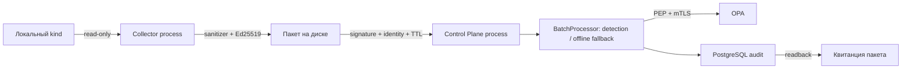

# Текущий срез архитектуры

Основание: часть B Stage −1, редакция 2.1, решения Python/kind от 10 октября.
Связанный общий план до MVP определяет дальнейшие Foundation, Shadow и L2;
локальный прототип не заменяет эти этапы.

S0-01: CLI → проверка локального URL → read-only doctor → PostgreSQL.
Миграции и создание среды выполняются отдельно от приложения.

S0-02: domain/common+models задают ограниченные frozen DTO; bind_diagnosis
связывает вывод с известным инцидентом и evidence, bind_recommendation
проверяет каталог и ставит ID, класс обратимости и поля безопасности.
Standalone Diagnosis проверяет структуру: на границе недоверенного вывода
обязательно использовать bind_diagnosis/validate_diagnosis с инцидентом.
AuditRecord дополнительно сверяет связи вложенных сущностей.

actions/catalog.py проверяет четыре определения и параметры. sources/synthetic.py
читает фиксированные файлы, не обращаясь к кластеру. CLI scenario list/show
не требует БД или API-ключа. source наблюдения не выполняет детекцию.
JSON Schema и эталоны проверяются контрактными тестами (29 после S0-08).
Валидация DTO не означает, что строка санитизирована: это отдельный механизм.

S0-03: env_guard принимает только project reader config и проверяет loopback,
CA pin, регистрацию, контекст, SA subject и TTL. safe_client вручную создаёт
SDK Configuration, разрешает только GET по списку путей и точному origin,
отключает redirects и проверяет expiry/namespace marker при каждом чтении.
Kubernetes SDK импортируется только этим модулем.

Developer scripts создают/удаляют собственный kind, настраивают RBAC и capture.
Они не являются интерфейсом исполнения приложения.

S0-04: KubernetesReadOnlySource → safe_client → allowlist-нормализация →
PodSnapshot. ObservationSource объединяет synthetic и local_kind. Контролируемая
пагинация, UID-фильтр Events, строгие статусы, UTF-8 лимиты, инъекция clock/ID.
Истинный ownerReference сохраняется, включая ReplicaSet (ADR-006).
CLI observe показывает только счётчики; сырые снапшоты остаются в памяти.

S0-05: DetectionEngine → очищенный Incident → ContextBuilder → DiagnosisContext.
Срабатывание задаёт текущий waiting reason, а не число прошлых рестартов.
Дедупликация включает origin и владельца, окно задано DetectionConfig.
Evidence формируются по allowlist, ограничиваются ContextLimits и очищаются
до сериализации. Контекст сохраняет ID evidence и хешируется канонически.
CLI detect работает на synthetic/local-kind и может показать очищенный контекст.

S0-06: AnalysisEngine → LLMClient → единый AnalysisDraft (диагноз + рекомендация).
Один запрос вместо двух независимых экономит контекст; максимум одна повторная
попытка. Раздельная привязка Draft сохраняет проверки diagnosis/evidence,
каталога, параметров и целевого workload (ADR-007). Поля безопасности назначает
приложение; недоступность, невалидный ответ или лимит вызывают rule fallback.
Промпт и контекст хешируются; метаданные готовы к аудиту следующего шага.
LLMLimits/RunBudget ограничивают каждый запрос и всю серию. FakeLLMClient
читает только подготовленные ответы по хешу. OpenAICompatibleClient поддерживает
фиксированный OpenRouter HTTPS и явно выбранный loopback endpoint; ключи раздельны.
Engine/prompt/fallback не могут импортировать транспорт или инфраструктуру.
CLI analyze работает без БД.

S0-07: ReviewService для одного Incident → AnalysisEngine → PolicyChecker →
DryRunEngine → PostgresAuditStore.append. CLI review выбирает один synthetic
сценарий. PolicyChecker разрешает только описание четырёх точных действий;
все реальные исполнительные capabilities заблокированы. Решение содержит
хеш incident/recommendation/catalog/policy; dry-run пересчитывает решение.
Summary строится шаблоном приложения, эффекты не проверяются. AuditStore
санитизирует и сверяет контекст, evidence, policy и dry-run; транзакционный
INSERT под app-ролью, без update/delete API. completed возвращается только
после записи. Ошибка БД прерывает CLI (ADR-008).

S0-08: Pipeline → ObservationSource → DetectionEngine → ReviewService → AuditStore.
SyntheticBatchSource или LocalKindSource владеют чтением и закрытием reader;
весь батч проверяется до анализа. Один общий LLM-бюджет, отдельные транзакции
аудита. NoIncidentObservation фиксирует успешную проверку без инцидента и
не создаёт фиктивных diagnosis/policy/dry-run. PipelineResult связывает итог
с аудитами, ошибки записи не превращаются в успешный батч.
PostgresAuditReader отделён от writer: метаданные ограничены, show проверяет
UUID/JSONB/контекст без переоценки исторической политики. CLI run/audit/eval
покрывает полный прототип. EvaluationReport содержит метрики десяти фикстур
и отдельно шесть ручных probes; model quality не оценивается (ADR-009).

Планируемый конвейер S0-02…S0-08: ObservationSource → DetectionEngine →
ContextBuilder/sanitizer → DiagnosisEngine → RecommendationEngine →
PolicyChecker → DryRunEngine → AuditStore. Контракты — Pydantic/JSON Schema.
FakeLLMClient обеспечивает бесплатные воспроизводимые тесты.

Сначала synthetic_fixture; local_kind добавляется с read-only SA и guards.
LLM предлагает структурированное действие из каталога. Поля безопасности
и итог dry-run формирует приложение. Исполнителя в прототипе нет.

F08: PEP → OpaClient → фиксированный HTTPS endpoint OPA. Отдельный pinned CA,
TLS 1.3, server IP SAN и точный DER fingerprint проверяются до POST; OPA проверяет
clientAuth и subject PEP. Trust/срок повторно проверяются после ответа.
Оператор выпускает identity ≤24 часов вне приложения; native PEM-ключи вне Git,
ACL/0600. CA-ключ не сохраняется. Это локальная аутентификация транспорта,
не разделение OS identity, SPIFFE или Cluster Agent. См. ADR-017.

F09 добавляет отдельные точки входа и локальный подписанный handoff:

Collector не импортирует LLM/DB/OPA; Control Plane не импортирует sources/SDK
или приватный signer. До анализа создаётся exclusive claim; повтор готового
пакета читает квитанцию и связанные записи без нового анализа. Незавершённый
claim автоматически не перехватывается. TelemetryProvenance добавляет связь
batch/hash/collector/registration/key в JSONB без новой миграции. Старый Pipeline
использует то же ядро через адаптер источника. Это один trusted OS user и файловый
транспорт, без сетевого Cluster Agent, durable workflow или исполнения. См. ADR-018.

UI01: браузер → локальный operator host (`scripts/dashboard-local.py`) → фиксированные
CLI children. Host не является модельным tool или частью Control Plane. GET API
читает bounded audit projection, POST запускает один local-kind/synthetic job с
обязательным OPA либо останавливает idle UI. Новых полномочий на исполнение,
policy/key management или снятие блокировки нет. Сам `aegisops.dashboard` содержит
только представление AuditRecord и локальные assets; транспорт/SDK/credentials
из него запрещены import-контрактом. См. ADR-019.

UI02: явная регистрация папки → ProjectRepository → bounded static scanner →
отдельный ProjectReport. Новая ветка не конвертирует source files в Kubernetes
Incident и не исполняет код. Host хранит общий single-job lock, а projects-модуль
не зависит от процессов/сети/моделей/БД. Реестр и 20 последних ссылок на отчёты
сохраняются в `.local/projects`; этот локальный формат не входит в F06 audit_runs.
Профиль и ограничения указаны в ADR-020.

UI04: сохранённый ProjectReport → закрытая проекция project-summary-v1 → явное
согласие оператора → durable claim → фиксированный runtime launcher → один
OpenRouter request → строгий Explanation → локальная история .local/project-ai.
Исходники/пути/значения/идентификаторы не включаются в запрос. Чистые модели,
проекция и хранилище отделены import-контрактами от транспорта и incident pipeline.
Новый worker не исполняет проектный код; модели недоступны tools/команды.
F01 и L0-контроль кластера сохраняются. См. ADR-022.
